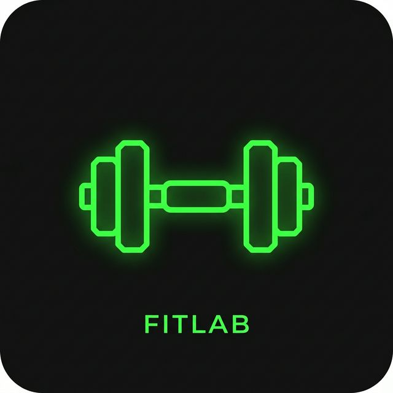

<div align="center">



# FitLab — AI-Powered Fitness Coach

**Your personal fitness companion. Powered by AI. Built for results.**

[](https://github.com/abhiMahata/FitLab/releases)
[](https://github.com/abhiMahata/FitLab)
[](https://reactjs.org/)
[](https://www.typescriptlang.org/)
[](LICENSE)

<br/>

[📲 Download APK](#-installation) · [✨ Features](#-features) · [🚀 Quick Start](#-quick-start) · [🏗️ Architecture](#️-architecture)

</div>

---

## About

**FitLab** is a full-featured, AI-enhanced fitness coaching application that lives right in your pocket. It goes beyond a simple workout logger — FitLab uses **real-time computer vision** (powered by Google MediaPipe) to analyze your exercise form, gives instant corrective feedback, tracks your nutrition, monitors your sleep, and keeps you accountable with streak tracking.

Built as a **React + TypeScript PWA** and packaged as a **native Android app** via Capacitor, FitLab delivers a premium, smooth, mobile-first experience with buttery Framer Motion animations throughout.

> *"Must've Been the Wind!"* — FitLab's splash screen tagline, and the last excuse you'll ever make.

---

## Features

###  AI Form Checker *(Flagship Feature)*
The crown jewel of FitLab. Using your phone's camera and **Google MediaPipe Pose Landmarker**, FitLab tracks your body skeleton in real-time and provides live corrective feedback:

- **Skeleton overlay** drawn directly over your live camera feed
- Detects common mistakes: `KNEES CAVING IN`, `SQUAT TOO DEEP`, `HIP SHIFT DETECTED`, `CAMERA NOT ALIGNED`
- Intelligently switches between **side-profile** and **frontal** views for full technique analysis
- Works for exercises like squats, lunges, and more

### Workout Roster
- Schedule exercises for each day of the week (Mon–Sun)
- Define sets and reps per exercise
- Dashboard auto-pulls today's workout to keep you on track

###  Calorie Tracker
- Log daily meals with precision
- Visualize **macros** (Proteins, Carbs, Fats) at a glance
- Stay on top of your nutritional goals

###  Water Intake Tracker
- Quick-log water with selectable bottle sizes (250ml → 1L)
- Circular progress ring on the Dashboard for instant status
- Integrated right into your daily overview

###  Sleep Tracker
- Log bedtime and wake time
- Track sleep cycles for optimal recovery
- Recovery data feeds into your overall performance picture

###  Streak & Stats Dashboard
- Time-aware greetings (*Good Morning / Afternoon / Evening*)
- Active streak counter with animated flame icon
- Quick stats: exercises planned, water intake, and day status
- Daily fitness fun facts for motivation
- One-tap shortcut to the AI Form Checker

###  Profile & Settings
- Light / Dark mode toggle
- Onboarding flow for new users
- In-app Help docs explaining every module

---

##  Installation

### Option A — Download the APK (Android)
Grab the latest release and sideload it onto your Android device:

1. Download **[FitLab-v1.2-Release.apk](./FitLab-v1.2-Release.apk)**
2. On your Android device, go to **Settings → Security → Install Unknown Apps** and allow your browser/file manager
3. Open the downloaded APK and tap **Install**
4. Launch **FitLab** 🚀

> **Note:** Camera permission is required for the AI Form Checker.

### Option B — Run Locally (Web)

```bash
# 1. Clone the repository
git clone https://github.com/abhiMahata/FitLab.git
cd FitLab

# 2. Install dependencies
npm install

# 3. Start the development server
npm run dev
```

The app will be available at `http://localhost:5173`.

To test on a phone connected to the same Wi-Fi network, run:

```bash
npm run dev -- --host
```

Then generate a QR code to quickly open on your device:

```bash
npx -y qrcode "http://[YOUR_LOCAL_IP]:5173"
```

---

##  Architecture

FitLab is a **React SPA** wrapped in a **Capacitor** shell for native Android distribution.

```
fitlab-ai-coach/
├── src/
│   ├── pages/              # Full-page route components
│   │   ├── Dashboard.tsx       # Home base & daily overview
│   │   ├── AIFormChecker.tsx   # Real-time pose analysis (MediaPipe)
│   │   ├── WorkoutRoster.tsx   # Weekly workout planner
│   │   ├── CalorieTracker.tsx  # Nutrition logging
│   │   ├── SleepTracker.tsx    # Sleep & recovery
│   │   ├── Profile.tsx         # Settings & user profile
│   │   ├── Login.tsx           # Firebase authentication
│   │   └── Onboarding.tsx      # First-run setup wizard
│   ├── components/         # Shared UI components
│   │   ├── BottomMenu.tsx      # Draggable swipe-up navigation sheet
│   │   ├── SplashScreen.tsx    # Animated launch screen
│   │   ├── AlarmScreen.tsx     # Sleep alarm interface
│   │   └── ui/                 # Radix UI base components
│   ├── lib/                # Utilities & services
│   │   ├── firebase.ts         # Firebase config & analytics
│   │   ├── authContext.tsx     # Auth state management
│   │   └── userProfile.ts      # LocalStorage profile helpers
│   └── App.tsx             # Root component & routing
├── android/                # Capacitor Android native project
├── assets/                 # App icons & static assets
├── capacitor.config.ts     # Capacitor configuration
└── vite.config.ts          # Vite build configuration
```

### Data Persistence
All user data (workout plans, food logs, sleep records, water intake) is stored locally using **`localStorage`** — no account or internet connection required for core functionality. Firebase is used for optional **authentication** and **analytics**.

---

## Tech Stack

| Layer | Technology |
|---|---|
| **Framework** | React 18 + TypeScript |
| **Build Tool** | Vite 5 |
| **Styling** | Tailwind CSS v3 |
| **Animations** | Framer Motion |
| **Icons** | Lucide React |
| **UI Primitives** | Radix UI |
| **Routing** | React Router v6 |
| **AI / CV** | Google MediaPipe Tasks Vision |
| **Auth & Analytics** | Firebase v12 |
| **Native Packaging** | Capacitor v8 (Android) |
| **Notifications** | Sonner |
| **Themes** | next-themes |

---

##  Building the Android APK

> See the full [Android Release Guide](./android_release_guide.md) for detailed steps.

```bash
# 1. Build the production web bundle
npm run build

# 2. Sync with the Android native project
npx cap sync android

# 3. Open in Android Studio (optional)
npx cap open android

# OR — build the release APK from CLI (Windows/Linux with Gradle)
cd android
./gradlew assembleRelease
```

The unsigned APK will be at:
`android/app/build/outputs/apk/release/app-release-unsigned.apk`

Sign it with your keystore, then zipalign for store distribution.

---

## Screenshots

> *(Coming soon — contributions welcome!)*

---

## Contributing

Contributions, issues, and feature requests are welcome!

1. Fork the repository
2. Create your feature branch: `git checkout -b feat/amazing-feature`
3. Commit your changes: `git commit -m 'feat: add amazing feature'`
4. Push to the branch: `git push origin feat/amazing-feature`
5. Open a Pull Request

---

##  License

This project is licensed under the **MIT License** — see the [LICENSE](LICENSE) file for details.

---

<div align="center">

Made with ❤️ by **Abhilash Mahata**

⭐ Star this repo if FitLab helps you crush your goals!

</div>
